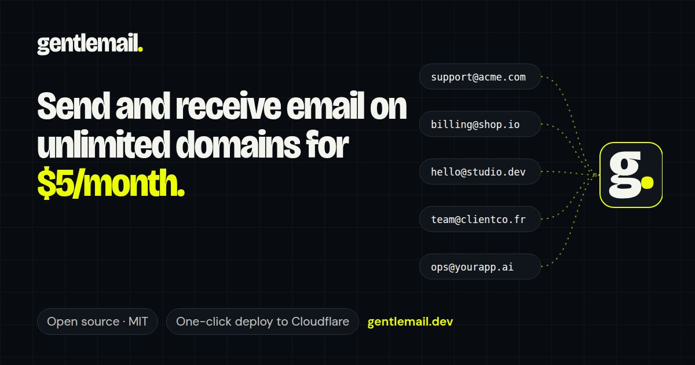
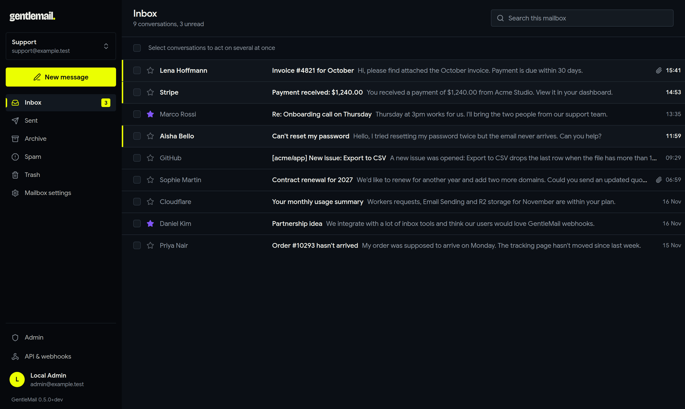
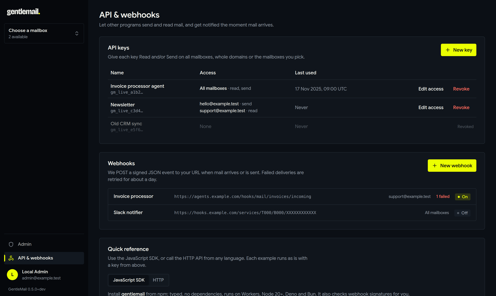
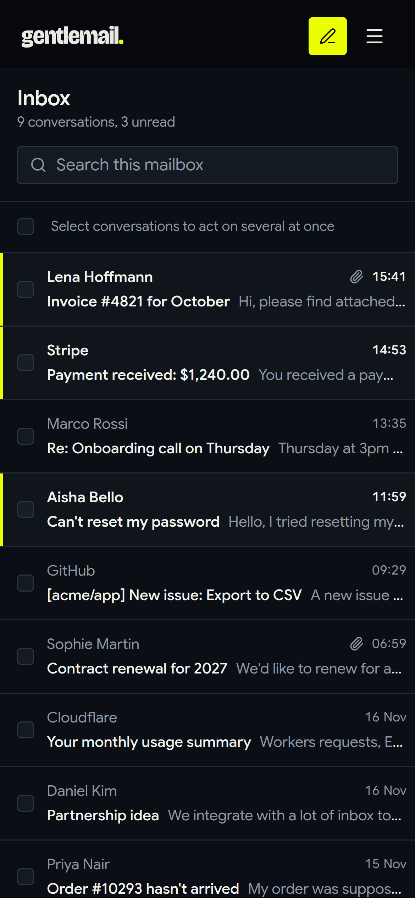
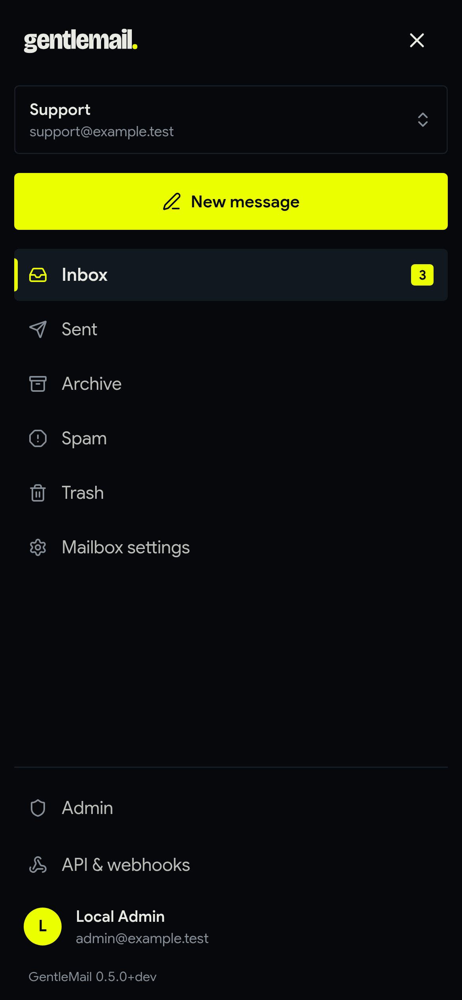

<p align="center"></p>

# GentleMail

Open-source, multi-domain webmail, email API and webhooks that run entirely on your own Cloudflare account.
One deployment serves any number of domains, mailboxes and people for the $5/month Workers Paid plan: no per-seat pricing, no API keys handed to a third party.

[](https://deploy.workers.cloudflare.com/?url=https://github.com/Softwaiz/gentlemail/tree/main/apps/mail)

**Website:** https://gentlemail.dev · **Deploy guide:** https://gentlemail.dev/docs/deploy/ · **Docs:** https://gentlemail.dev/docs · **[Changelog](CHANGELOG.md)**

- **Inbox and outbox**: a real webmail for people (conversations, search, attachments, spam folder, blocking) and a REST API for code.
- **Many domains, one deployment**: add domains and mailboxes in Admin, and choose which people can open which mailboxes.
- **Webhooks**: signed `message.received` and `message.sent` events with retries, to automate invoices, support alerts and more.
- **AI assistants (MCP)**: connect Claude, ChatGPT or Cursor by signing in; they search, read and answer mail in the mailboxes you tick, and ask before sending.
- **Your infrastructure**: mail is stored in your own D1 database and R2 bucket, and sent with Cloudflare Email Service.

<p align="center"></p>

<table>
  <tr>
    <td width="60%"></td>
    <td width="20%"></td>
    <td width="20%"></td>
  </tr>
  <tr>
    <td align="center">API keys and webhooks</td>
    <td align="center" colspan="2">On a phone</td>
  </tr>
</table>

## Deploy your own

1. **Deploy.** Click **Deploy to Cloudflare** above. Cloudflare copies the app into a new repository on your GitHub account, creates the database and storage, asks for a one-time `SETUP_TOKEN`, then builds and deploys.
   Using a fork or clone of this whole repository with Workers Builds instead? Set **Root directory** to `apps/mail`.
2. **Claim it.** Open `/setup` on your new Worker and create the admin account.
3. **Connect a domain.** Add it in **Admin → Domains** and run the three commands it shows.
4. **Create mailboxes and users**, then send yourself a test message.

You need a Cloudflare account on Workers Paid and a domain whose DNS is on Cloudflare. The full guide (every step, configuration, an end-to-end test, updating and troubleshooting) is in **[apps/mail/README.md](apps/mail/README.md)**.

## No Cloudflare API token
GentleMail never asks for a Cloudflare API token or account ID: it reaches D1, R2 and Email Service through Worker bindings. [More on why](apps/mail/README.md#gentlemail).

## Repository
A small [pnpm workspace](https://pnpm.io/workspaces) monorepo with one app today.

```
.
├── apps/
│   ├── mail/              the app: webmail, REST API and webhooks (one Cloudflare Worker)
│   └── docs/              the documentation site, served at gentlemail.dev/docs (Astro Starlight)
├── packages/
│   └── sdk/               the JavaScript SDK, published to npm as `gentlemail`
├── package.json           workspace scripts
├── pnpm-lock.yaml
└── pnpm-workspace.yaml
```

`apps/mail` is the folder the Deploy button copies and the **Root directory** for Workers Builds. It has its own `package.json`, `wrangler.jsonc` and migrations. Its README has the [tech stack](apps/mail/README.md#tech-stack) (Workers, RedwoodSDK, D1 with plain SQL and **no ORM**, R2, Email Service), [database and migration commands](apps/mail/README.md#database-and-migrations), a [file-by-file layout](apps/mail/README.md#layout) and every [script](apps/mail/README.md#scripts).

### Commands
From the repository root:
```sh
pnpm install
pnpm dev:mail                                    # local dev server, http://localhost:5173
pnpm --filter @emails/mail db:migrate:local      # apply migrations to the local database
pnpm types                                       # type-check
```
The lockfile is the workspace's `pnpm-lock.yaml`, so pnpm is the tool for this repository. Inside `apps/mail`, the everyday scripts (`dev`, `build`, `deploy`, `db:migrate:*`) also run with npm; `check` and `release` call pnpm.

## Fork it

Missing something your product needs, like a mailboxes API, forwarding, or delivery to Telegram? Fork it and add it: mail comes in through `apps/mail/src/lib/inbound.ts` and goes out through `apps/mail/src/lib/outbound.ts`. Issues, discussions and pull requests are welcome.

## Star History

[](https://www.star-history.com/?repos=softwaiz%2Fgentlemail&type=date&legend=top-left)

## License

[MIT](LICENSE) © Softwaiz
